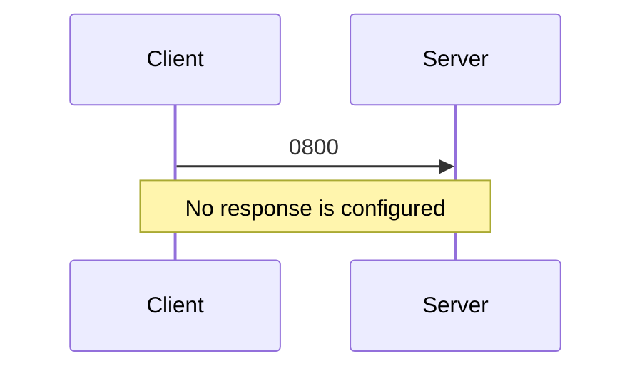
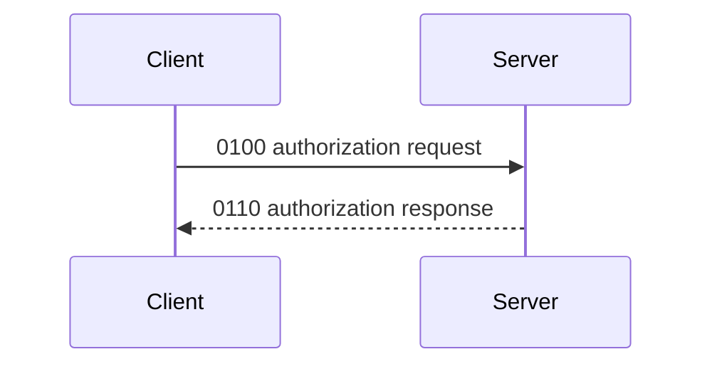
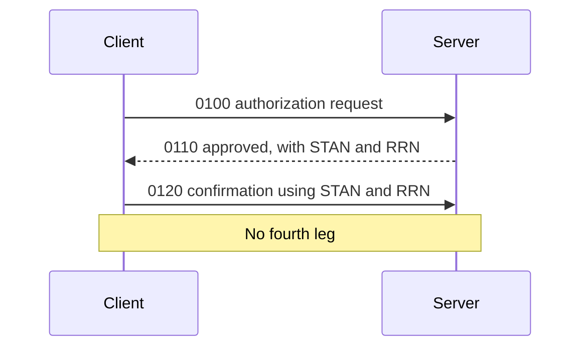

# Transaction Flows Without the Mystery

A **leg** is one message traveling in one direction. It does not mean one TCP
connection and it does not necessarily mean one business transaction.

## One leg: send and finish



The client action uses `"expect_response": false`. The server's MTI rule uses
`"default": null`. Both sides know the silence is intentional.

Run it:

```bash
python3 client.py --rules client-rules/network-no-response.json
```

## Two legs: ordinary request and response



After receiving `0110`, the client loads `responses/stop.json`. Its default is
`null`, so the flow ends cleanly.

This is the normal shape of the authorization, financial, and reversal demos.

The lab includes five explicit working MTI pairs:

| Request | Response | Purpose |
| --- | --- | --- |
| `0100` | `0110` | Authorization |
| `0220` | `0230` | Financial advice |
| `0420` | `0430` | Reversal advice |
| `0600` | `0610` | Administrative request |
| `0800` | `0810` | Network sign-on |

Run the added scenarios with:

```bash
python3 client.py --rules client-rules/financial-advice.json
python3 client.py --rules client-rules/administrative-request.json
python3 client.py --rules client-rules/network-sign-on.json
```

## Three legs: response followed by confirmation



The important sequence is:

1. The client sends the start message and waits.
2. The server validates `0100` and sends `0110`.
3. Client rules capture DE11 (`$stan`) and DE37 (`$rrn`).
4. The next message expands those registers into `0120`.
5. That action has `expect_response: false`, so the client stops waiting.
6. Server rules for `0120` use `default: null`, so the server sends nothing.

All three legs use the same TCP connection.

Run it:

```bash
python3 client.py --rules client-rules/three-leg-authorization.json
```

## Who remembers what?

| State | Lifetime |
|---|---|
| Client registers | The complete client TCP connection |
| Server registers | One incoming message only |
| Selected spec | The process lifetime |
| Server listener | Until stopped, or one session with `--once` |

If the server must correlate separate messages, carry correlation values such
as STAN, RRN, or original data in the messages. This lab does not include a
transaction database.

## How the next leg is selected

On the server:

1. Incoming MTI selects a per-MTI rule file.
2. Captures are calculated.
3. First matching rule selects a response template.
4. A null default means no response.

On the client:

1. Received MTI selects a client response-rule file.
2. Captures are added to persistent client registers.
3. First matching rule selects the next message.
4. A null next/default ends the flow.

There is no built-in maximum number of legs. That makes longer conversations
possible, but a circular rule configuration can keep going forever. When
building a new flow, sketch the MTIs first and make every exit explicit.

## Silence versus failure

These cases look similar on the wire but mean different things:

| Situation | Client configuration | Result |
|---|---|---|
| Planned terminal message | `expect_response: false` | Clean success |
| Expected response never arrives | `expect_response: true` | Timeout, exit code 2 |
| Server closes early | Response expected | Connection error, exit code 3 |
| Client has no rules for received MTI | No `responses` entry | Flow ends cleanly |

Use `--drop-response` on the server to demonstrate a genuinely lost response.
Use a null server rule plus `expect_response: false` to demonstrate an MTI
that deliberately has no response.

## Building a new flow

Use this checklist:

1. Create every outbound message under `messages/`.
2. Add server handling for every MTI the client sends.
3. Create client response rules for every response that can continue the flow.
4. Capture values before a later message references them.
5. Mark the final outbound message with `expect_response: false` when no reply exists.
6. Test the first message with `--dry-run`.
7. Run the complete exchange with `--log-view both`.
